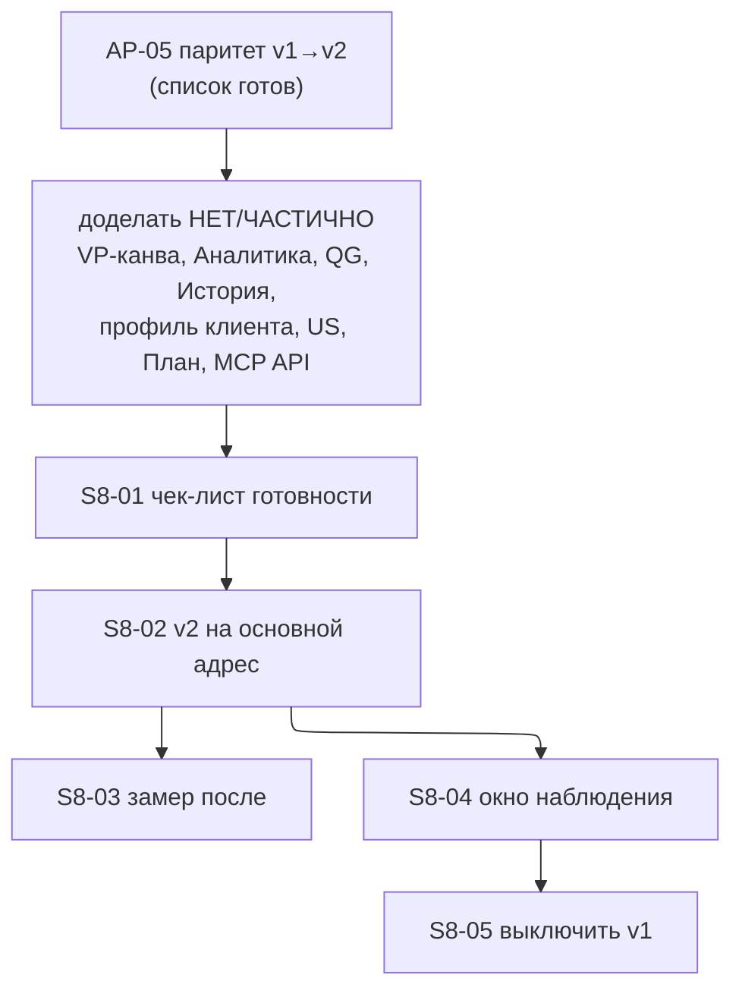

# UnlimitedLORE — заблокированные задачи и что нужно для разблокировки

Срез прода LORE, 14.11.2026, ~22:00 UTC. В 🔴 BLOCKED **29 задач** из 89 открытых.
С утра блок снят с четырёх: [[task:SPRINT_LORE_MD_ARCHIVE/MDA-01]], MDA-02, MDA-03 и MDA-04 — по вашему «mda1 да».

Сводка — кто разблокирует:

| Кто | Задач | Что нужно |
|---|---|---|
| **Вы — решение или данные** | 10 | 7 вопросов, ниже по буквам |
| **Сессия CICDGitHub** (KC, секреты, инфраструктура) | 6 | её работа; можно отдать ей пачкой |
| **Сессия Völva** (сейчас не на связи) | 8 | доделать встройку Völva |
| **Цепочка переезда v1 → v2** | 4 | сначала AP-05 → S8-01 |
| **Внешнее** | 1 | выход TypeScript 7.1 |

---

## 1. Ждут вас — 10 задач

### А. TEST-учётки для приёмки RBAC — 3 задачи (самый большой выигрыш)
- [[task:SPRINT_LORE_ADMIN_POLISH/AP-02]] — прогон 82 кейсов RBAC и админки
- [[task:SPRINT_LORE_ADMIN_POLISH/AP-06]] — «+ Новая» по всем типам под ролями pm/developer/reader
- [[task:SPRINT_UXR_S11_TEST_OPT/E2E-STAND]] — смоук v2 после каждой выкатки

**Что сделать вам:**
1. Пароли и сохранённые входы test-sa / admin / viewer / user-1..3. Пароль вводите сами в браузере, агент сохранит вход (storageState).
2. Завести TEST-proj-a и TEST-proj-b — или сказать «заводите».
3. Да или нет: гоняем RBAC-тесты на проде?
4. Кто гонит кейсы под токеном агента: секрет агенту не выдаётся.
5. AD-43: истина — спека или экран «Машины»?

### Б. Что выключаем из модели — 1 задача
- [[task:SPRINT_LORE_MODEL_DOCS_TIDY/MD-02]]

**Что сделать вам:** решить по трём пунктам — ClRoutineOutput; поля rationale_md решения и decisions_md вехи; KnowFindingHist. Варианты: снять, перенести или оставить.
Часть про устаревшие ADR и спеки уже решена: её делает рутина [[task:SPRINT_QG_REBUILD/QG-STALE-DOCS]].

### В. Прототип экрана «Модель» — 1 задача
- [[task:SPRINT_LORE_MODEL_AS_CONFIG/MC-06]]

**Что сделать вам:** посмотреть `docs/prototypes/mc-06-model-screen.html` и ответить «approve» или что поправить.

### Г. Нижнее меню на телефоне — 1 задача
- [[task:SPRINT_UXR_MOBILE_POLISH/MP2-15-BOTTOM-BAR]]

**Что сделать вам:** два ответа.
1. Прятать ли нижнее меню модулей, когда показан один модуль?
2. Зона касания пилюль: 16–18 px при overflow:hidden — оставить или увеличить?

### Д. Пять спринтов без компонента — 1 задача
- [[task:SPRINT_LORE_ROADMAP_PER_PROJECT/RM-P3]]

**Что сделать вам:** по каждому из пяти спринтов (список в теле задачи) назвать компонент или сказать «закрыть».

### Е. Ключ и бюджет LLM — 2 задачи (+ хвост QG-11 и рутины)
- [[task:SPRINT_QG_REBUILD/QG-15]] — модуль вызова LLM по образцу MIMIR
- [[task:SPRINT_QG_REBUILD/QG-01]] — переписать quality gates

**Что сделать вам:** какой ключ (провайдер или локальная машина) и какой месячный бюджет. Ключ в Infisical кладёт CICDGitHub.
От этого же зависят шаги 3–4 [[task:SPRINT_QG_REBUILD/QG-11]] и LLM-часть [[task:SPRINT_QG_REBUILD/QG-STALE-DOCS]].

### Ж. Уборка на 131 — 1 задача
- [[task:SPRINT_LORE_OWN_HOST/OH-14]]

**Что сделать вам:** не раньше 15.11 дать слово по каждому пункту уборки (список в теле задачи). Исполнитель — CICDGitHub.

---

## 2. Ждут сессию CICDGitHub — 6 задач
Настройки Keycloak, Infisical, секретов и инфраструктуры меняет только она (правило 14.11).

- [[task:SPRINT_LORE_AGENT_OBSERVABILITY/AO-AGENT-ADD-INFISICAL]] — секрет агента сразу в Infisical
- [[task:SPRINT_LORE_PRODUCT_BACKLOG/DBR-01]] — свой API-токен ArcadeDB вместо root
- [[task:SPRINT_LORE_PROJECT_SCOPE/AL-105]] — учётка KC на агента с родителем в токене
- [[task:SPRINT_LORE_OWN_HOST/OH-15]] — слабый root-пароль ArcadeDB, порты открыты в LAN
- [[task:SPRINT_LORE_OWN_HOST/OH-16]] — сброс пароля admin Nexus (в окно, которое назначите вы)
- [[task:SPRINT_LORE_PRODUCT_FIT/FIT-09]] — KC-клиент для агента product-analyst

**Что сделать вам:** сказать «отдай пачкой» — я передам ей список одним сообщением.

---

## 3. Ждут сессию Völva — 8 задач
Сессия «Доделка спринтов для lore» (80e0681b) сейчас не на связи.

- [[task:SPRINT_VIZ_EMBED/VE-4]] — тема встройки: высота 320 и белый фон в тёмной теме; нужны Völva 0.1.11, VE-5, VE-7
- [[task:SPRINT_VIZ_EMBED/VE-6]] — проба приёмки, после VE-4 и VE-7
- [[task:SPRINT_UXR_S6_VOLVA_IN_LORE/S6-01]], [[task:SPRINT_UXR_S6_VOLVA_IN_LORE/S6-02]], [[task:SPRINT_UXR_S6_VOLVA_IN_LORE/S6-03]], [[task:SPRINT_UXR_S6_VOLVA_IN_LORE/S6-05]], [[task:SPRINT_UXR_S6_VOLVA_IN_LORE/S6-06]], [[task:SPRINT_UXR_S6_VOLVA_IN_LORE/S6-07]] — аналитика Völva внутри LORE, ждут принятой встройки

**Что сделать вам:** поднять сессию Völva. Задачи у неё в работе: [[task:SPRINT_VIZ_EMBED/EMB-L2]], [[task:SPRINT_VIZ_EMBED/VE-3]], [[task:SPRINT_VIZ_EMBED/VE-7]], [[task:SPRINT_VIZ_EMBED/VOLVA-EMBED-1]].

---

## 4. Цепочка переезда v1 → v2 — 4 задачи
Ваше решение: «мы не чиним, мы переезжаем».

- [[task:SPRINT_UXR_S8_SWITCH/S8-02]], [[task:SPRINT_UXR_S8_SWITCH/S8-03]], [[task:SPRINT_UXR_S8_SWITCH/S8-04]], [[task:SPRINT_UXR_S8_SWITCH/S8-05]]

Сверка [[task:SPRINT_LORE_ADMIN_POLISH/AP-05]] на проде готова:
- **нет в v2:** VP-канва, Аналитика (в v1 дашборд на 7 вкладок), QG, общая История;
- **частично:** профиль клиента, US (слиты с «Фичами»), План (таймлайн без дорожек и вех), MCP API;
- **BRAGI, MUNINN, TYR:** осознанно «скоро».

**Что сделать вам:** подтвердить, что всё из «нет» и «частично» нужно до переключения, или назвать то, что можно перенести после.

---

## 5. Внешнее — 1 задача
- [[task:SPRINT_LORE_PRODUCT_BACKLOG/VD-01]] — TypeScript 7: ждём выхода TS 7.1. От вас ничего не нужно.

---

## Ещё два ваших ответа (задачи не в BLOCKED, но стоят)
- **[[task:SPRINT_LORE_MD_ARCHIVE/MDA-01]], п.1 — состав архива.** Ваше правило: «людей — только имя и логин, агент — только видимое имя без идентификатора». Нужно уточнить: это для архива, для карточек «Люди» на телефоне или для обоих? И входит ли в архив продуктовый слой (боли, выгоды, работы)?
- **[[task:SPRINT_LORE_ADMIN_POLISH/AP-01]] — удаление тестового агента TestUat на проде.** Пробный прогон сделан: план из 4 изменений, ничего не удалено. Нужно ваше «да».
